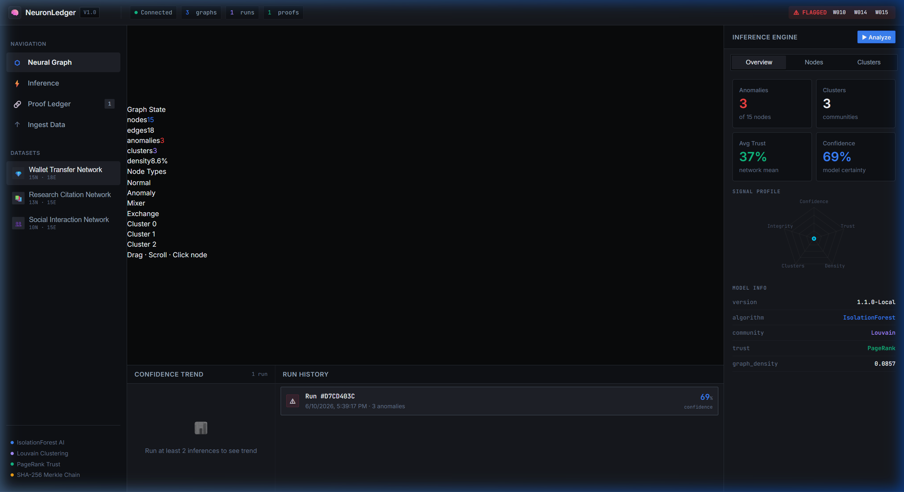
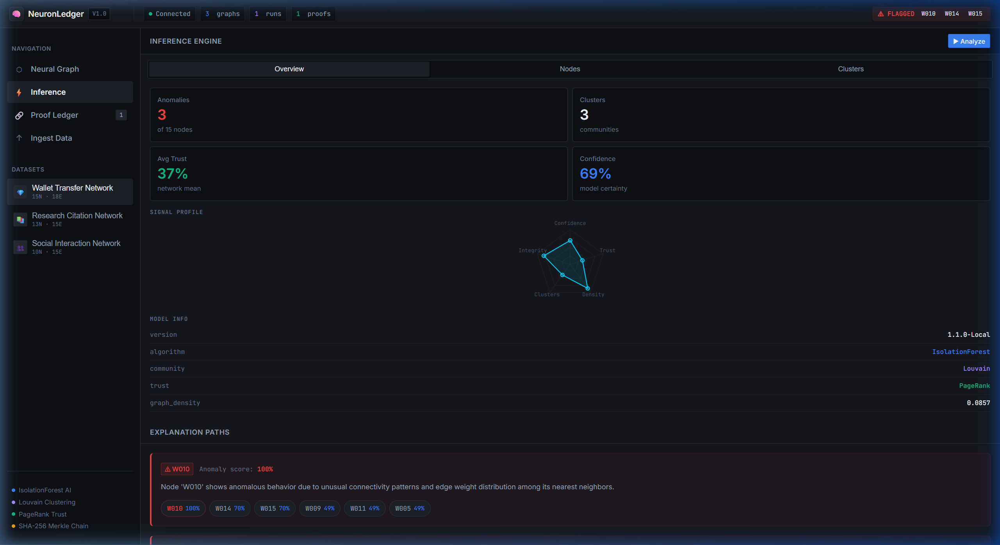

# 🧠 NeuronLedger: Graph Neural AI with Verifiable Memory

NeuronLedger is an advanced, full-stack cybersecurity and data-analysis platform that merges **3D Data Visualization**, **Artificial Intelligence**, and **Web3 Blockchain Cryptography**.



## 📖 The Problem
In traditional systems, when an AI flags a threat (like a cyber attack or a money-laundering syndicate), the AI operates as a "black box". A rogue database administrator could secretly alter the AI’s report in the database to hide their tracks. 

**NeuronLedger solves this** by generating immutable, cryptographically verifiable proof of every AI conclusion on a public blockchain.

## ✨ Core Features

### 1. 3D Neural Visualizer
Instead of flat, unreadable tables, NeuronLedger ingests massive datasets and renders them as a dynamic, physics-based 3D floating web. 


### 2. Graph Mathematics Engine
Beneath the visual layer, the Python backend runs rigorous structural algorithms (like **PageRank**, **Louvain Clustering**, and **Degree Centrality**) to find abnormal spikes and hidden networks.

### 3. AI Forensic Brain
We feed the raw mathematical outputs directly into the **Google Gemini LLM**. Acting as a cybersecurity expert, the AI reads the math and translates it into a human-readable forensic report.


### 4. The Cryptographic Proof Ledger
The exact moment the AI generates its report, the backend compresses the entire state (input data, graph state, AI output) into a single SHA-256 **Merkle Root**. Using Web3, a transaction is broadcast to the **Ethereum Sepolia Testnet**. If anyone attempts to alter the AI's report in the database, the cryptographic hash breaks, instantly flagging an "Integrity Breach".

---

## 🚀 Quick Start Guide

Follow these steps to run NeuronLedger locally.

### Prerequisites
- Python 3.12+
- Node.js (v18+)
- An Alchemy API Key (for Ethereum Sepolia)
- A Google Gemini API Key

### 1. Backend Setup (FastAPI)
Open a terminal and run:
```bash
cd backend
python -m venv venv

# Windows
.\venv\Scripts\activate
# Mac/Linux
source venv/bin/activate

pip install -r requirements.txt
```

Create a `.env` file in the `backend/` folder:
```env
GEMINI_API_KEY=your_gemini_key_here
WEB3_PROVIDER_URI=your_alchemy_sepolia_url_here
WALLET_PRIVATE_KEY=your_ethereum_wallet_private_key
```

Run the backend:
```bash
uvicorn main:app --reload --port 8000
```

### 2. Frontend Setup (React/Vite)
Open a second terminal and run:
```bash
cd frontend
npm install
npm run dev
```

The app will be available at `http://localhost:5173`.

---

## ☁️ Deployment Guide (Vercel & Render)

**Can you host the backend on Vercel?**
While Vercel is incredible for frontend hosting, it is **not recommended** for this backend. Vercel uses "Serverless Functions" which spin up and down constantly. This means local files like our `neuronledger.db` SQLite database would be wiped out every few minutes, and long-running mathematical graph algorithms might time out.

**Recommended Deployment Stack:**
1. **Frontend:** Deploy the `frontend/` folder to **Vercel** or Netlify. It works perfectly there!
2. **Backend:** Deploy the `backend/` folder to **Render** or **Railway**. These services provide persistent containers that won't delete your SQLite database, and they can handle the heavy Python background tasks.
